

  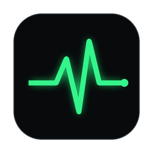

<h1 align="center">NetPulse</h1>

  Мониторинг доступности сети и сервисов для macOS и Windows. 
  Видно не только <b>что</b> упало, но и <b>где</b> рвётся связь — у вас, у провайдера или на стороне сервиса.

  <a href="https://github.com/stailegrow/NetPulse/releases/latest"><b>⬇ Скачать последнюю версию</b></a>
  &nbsp;·&nbsp; macOS (Apple Silicon и Intel) &nbsp;·&nbsp; Windows 10 / 11

  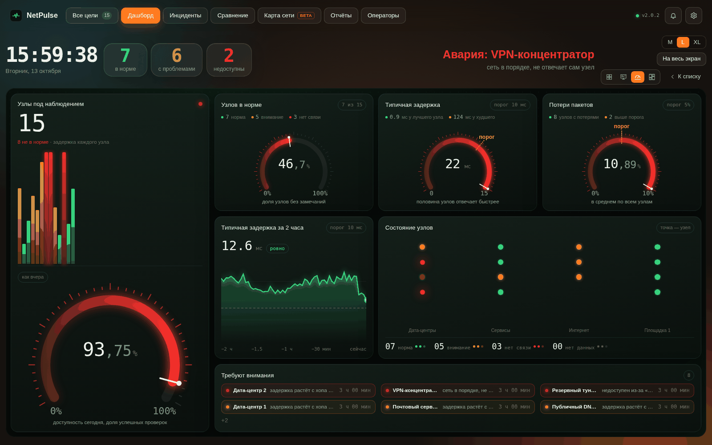

---

## Что умеет

**Непрерывные проверки.** Трассировка ICMP по всем узлам маршрута, Ping, HTTP(S) с кодом ответа, ключевым словом и сроком SSL-сертификата, TCP-порт, DNS. Для каждой цели — текущая и средняя задержка, jitter, потери, MOS для IP-телефонии, аптайм за сутки и неделю.

**Поиск места обрыва.** Программа сама разбирает трассировку и пишет вывод простыми словами: «сеть в порядке, не отвечает сам узел», «задержка растёт с хопа 6 — транзитный оператор». Смена маршрута и смена IP-адреса у имени тоже отслеживаются.

**Уведомления без спама.** Одна авария — одно сообщение, которое обновляется до восстановления. Короткие обрывы уходят только в историю. Каналы: уведомления на компьютере и звук, Телеграм, почта, Slack / Discord / вебхук.

**Работает в фоне.** При закрытии окна мониторинг продолжается в трее или меню-баре, цвет значка показывает, есть ли проблемы. Права администратора не нужны.

<table>
  <tr>
    <td width="50%">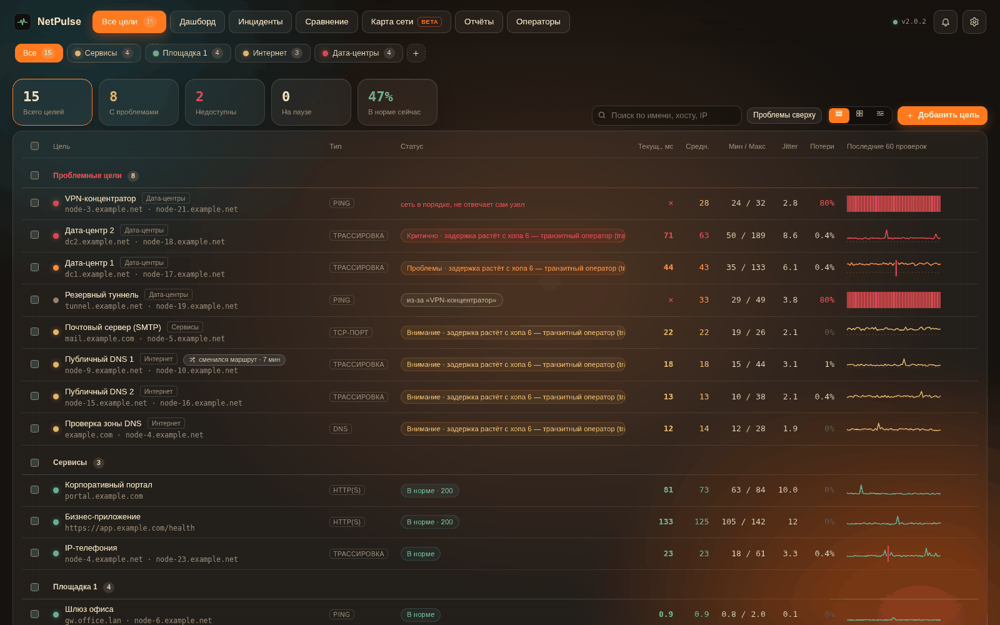</td>
    <td width="50%">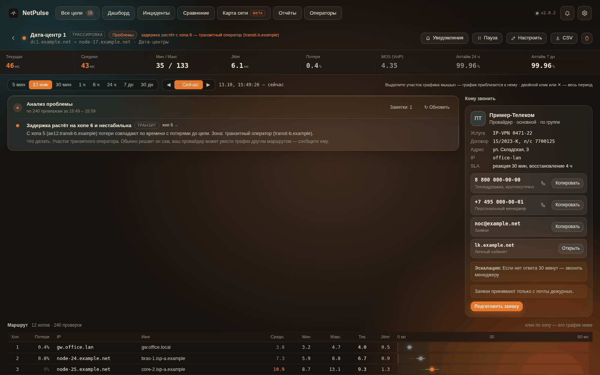</td>
  </tr>
  <tr>
    <td><b>Все цели</b> — статус, задержка, потери и мини-график последних проверок. Цели разбиваются на группы, проблемные поднимаются наверх.</td>
    <td><b>Страница цели</b> — графики с зонами порогов, анализ проблемы, маршрут по хопам и «кому звонить».</td>
  </tr>
</table>

## Дашборд для стены и второго монитора

Четыре вида на выбор, переключаются одной кнопкой; режим «на весь экран» для дежурной смены.

<table>
  <tr>
    <td width="50%">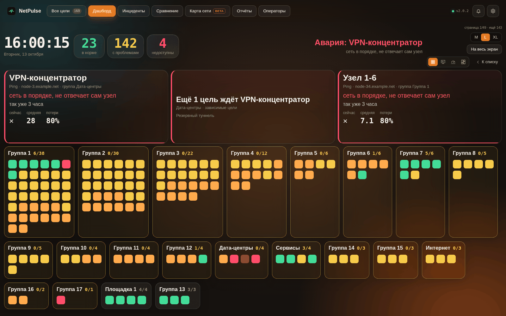</td>
    <td width="50%">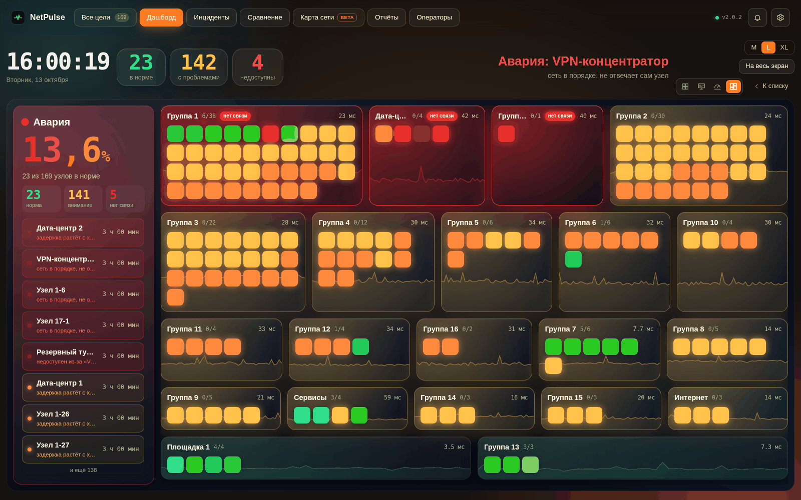</td>
  </tr>
  <tr>
    <td><b>Мозаика</b> — аварии крупно, ниже все группы плиткой: каждый квадрат — узел.</td>
    <td><b>Бенто</b> — каждый узел отдельным квадратом с задержкой, график группы на фоне.</td>
  </tr>
  <tr>
    <td>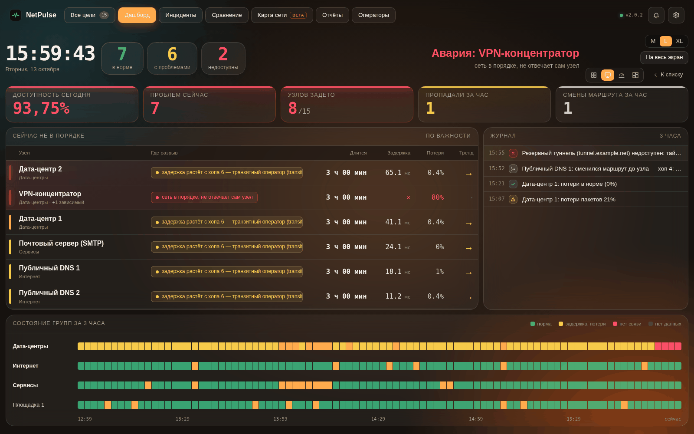</td>
    <td></td>
  </tr>
  <tr>
    <td><b>Пульт дежурного</b> — что не в порядке и где разрыв, журнал событий, полосы состояния групп за 3 часа.</td>
    <td><b>Обзор</b> — доступность за сегодня, доля узлов в норме, типичная задержка и потери на шкалах с порогами.</td>
  </tr>
</table>

## Инциденты, карта сети, отчёты

<table>
  <tr>
    <td width="50%">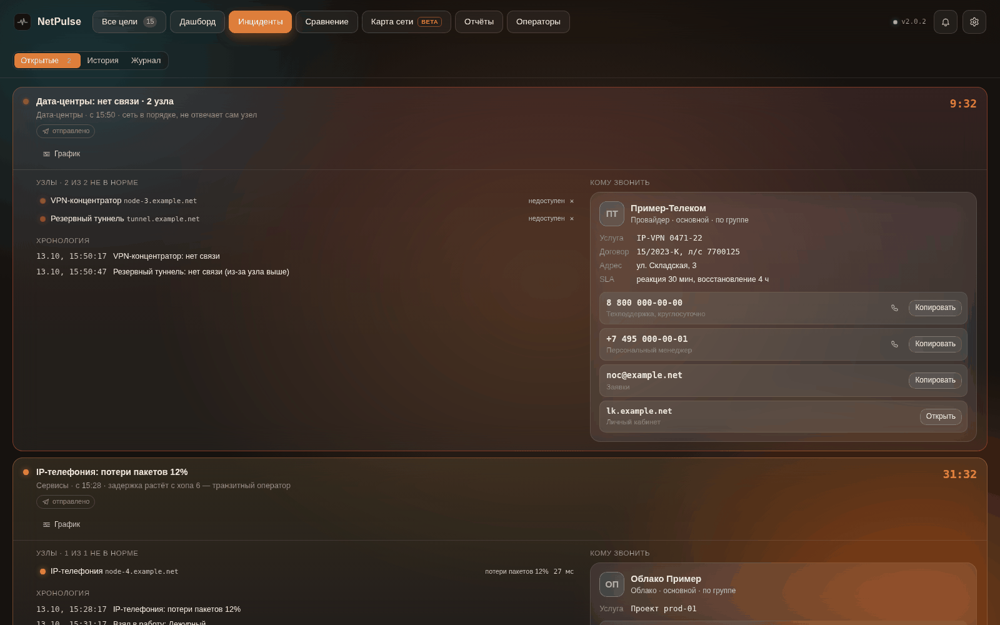</td>
    <td width="50%">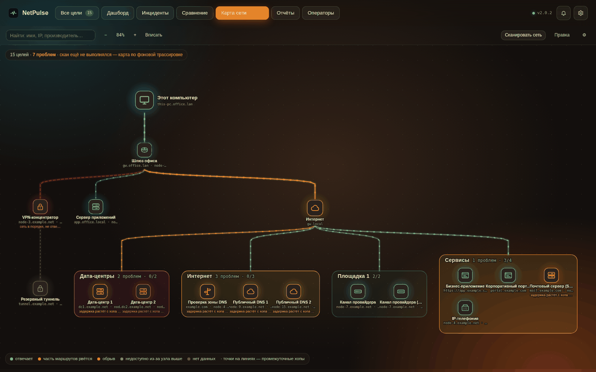</td>
  </tr>
  <tr>
    <td><b>Инциденты</b> — падения одной площадки склеиваются в один случай: хронология, затронутые узлы, контакты оператора и готовый текст заявки.</td>
    <td><b>Карта сети</b> beta — схема, построенная по трассировкам: видно, на каком участке пути проблема.</td>
  </tr>
  <tr>
    <td>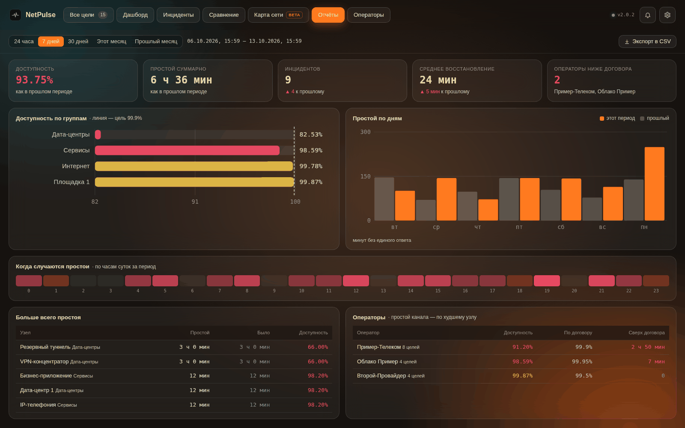</td>
    <td>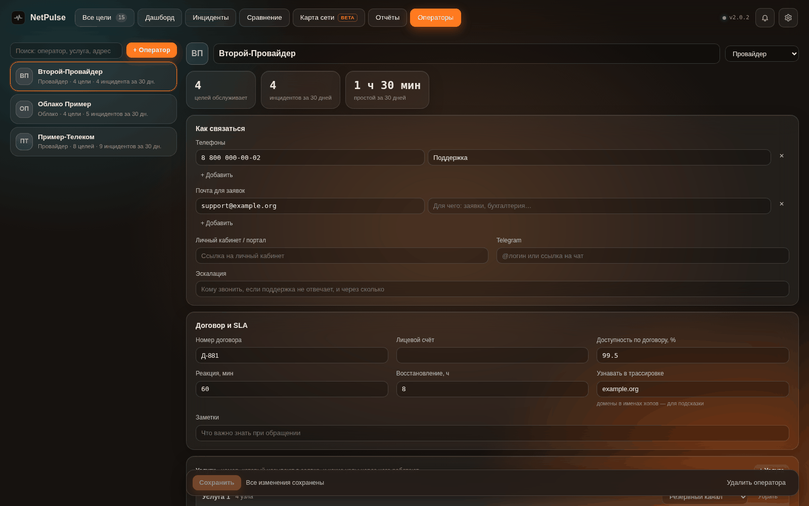</td>
  </tr>
  <tr>
    <td><b>Отчёты</b> — доступность и простои за период со сравнением с прошлым, по группам, дням и часам; операторы против договора; выгрузка в CSV.</td>
    <td><b>Операторы</b> — провайдеры, ЦОД и подрядчики: телефоны, почта для заявок, договоры, SLA и услуги, привязанные к узлам.</td>
  </tr>
  <tr>
    <td colspan="2">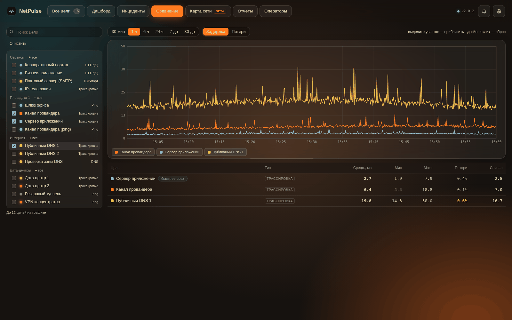</td>
  </tr>
  <tr>
    <td colspan="2"><b>Сравнение</b> — несколько целей на одном графике: например, два канала разных провайдеров или несколько DNS-серверов.</td>
  </tr>
</table>

## Бесплатная и полная версии

|                                                         | Бесплатная версия | Полная версия (по ключу) |
|---------------------------------------------------------|:-----------------:|:------------------------:|
| Узлов под наблюдением                                    | до 10             | без ограничений          |
| Все типы проверок, графики, трассировка, анализ проблем | ✓                 | ✓                        |
| Сравнение целей                                         | ✓                 | ✓                        |
| Уведомления: компьютер, Телеграм, почта, вебхук          | ✓                 | ✓                        |
| Дашборд (4 вида)                                        |                   | ✓                        |
| Инциденты                                               |                   | ✓                        |
| Карта сети                                              |                   | ✓                        |
| Отчёты                                                  |                   | ✓                        |
| Операторы                                               |                   | ✓                        |

Ключ вводится в программе: **Настройки → Лицензия**.

**Кому какая лицензия**

- **Некоммерческая — бесплатно:** личное, учебное и другое некоммерческое использование.
- **Коммерческая — по ключу:** использование в организации или у ИП, обслуживание сети работодателя или клиентов, платные услуги — любая деятельность, приносящая доход. Организация может бесплатно попробовать программу в течение 30 дней.

Подробные условия — в [EULA.md](EULA.md). Чтобы приобрести коммерческую лицензию, напишите правообладателю: [github.com/stailegrow](https://github.com/stailegrow).

## Установка

**macOS.** Откройте `NetPulse_<версия>_universal.dmg` и перетащите NetPulse в «Программы». Приложение подписано без сертификата Apple Developer ID, поэтому при первом запуске macOS попросит подтверждение: «Системные настройки» → «Конфиденциальность и безопасность» → «Всё равно открыть». Это нужно один раз.

**Windows.** Запустите `NetPulse_<версия>_x64-setup.exe` — права администратора не нужны. Есть и портативная версия `NetPulse_<версия>_portable.exe`, работающая без установки. При первом запуске SmartScreen может показать предупреждение: «Подробнее» → «Выполнить в любом случае».

Установленная программа сама предлагает обновиться, когда выходит новая версия.

## Полезное

**Где хранятся данные**

| ОС | Путь |
|---|---|
| macOS | `~/Library/Application Support/com.netpulse.monitor/netpulse.db` |
| Windows | `%APPDATA%\com.netpulse.monitor\netpulse.db` |

Список целей с настройками можно выгрузить в файл и загрузить на другом компьютере — секреты (токены, пароли, ключ лицензии) в файл не попадают.

**Горячие клавиши:** `⌘N` / `Ctrl+N` — новая цель · `⌘,` / `Ctrl+,` — настройки · `Esc` — назад к списку.

Все данные на скриншотах — демонстрационные: имена узлов и адреса вымышлены.

## Лицензия

Проприетарная лицензия, все права защищены — см. [LICENSE](LICENSE).
Исходный код открыт **только для чтения**: копирование, изменение, сборка,
распространение, декомпиляция, обход проверки ключа и копирование дизайна
запрещены. Условия использования приложения — некоммерческое бесплатно,
коммерческое по ключу — в [EULA.md](EULA.md).

Сторонние компоненты распространяются под собственными лицензиями (список —
в конце файла [LICENSE](LICENSE)).

**Licence** — proprietary, all rights reserved (source-available, read-only). Non-commercial use is free; commercial use requires a licence key. See [LICENSE](LICENSE) and [EULA.md](EULA.md); third-party components keep their own licences.

© 2026 StaileGroW · Автор: Sorokin Maksim
